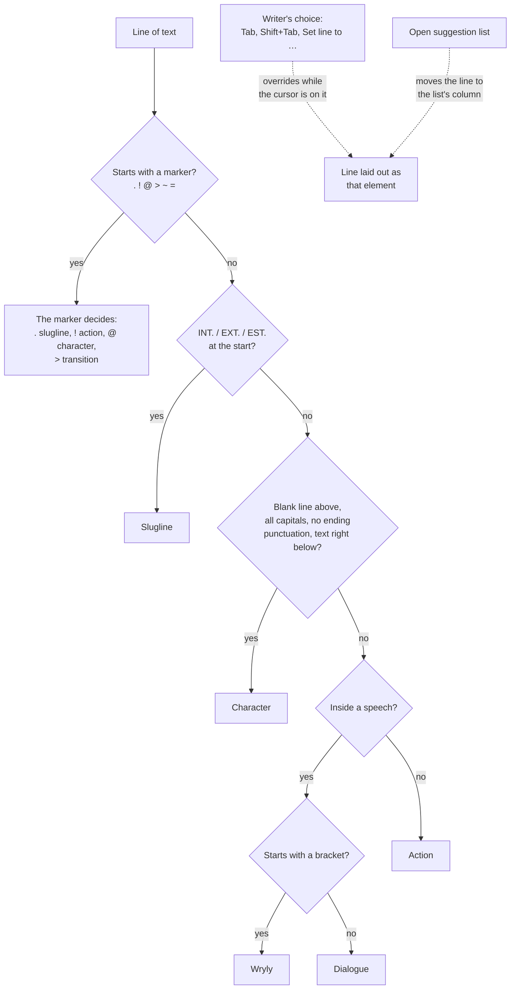

# Screenwriting editor behavior: decisions and test cases

This is a plain-English record of how Scribidian's script-mode editor should
behave while someone types a screenplay, and of the cases worth testing. Each
rule came from hands-on testing, and most match Fade In or Final Draft. It is
written to be read by people and by AI coding assistants. Keep it up to date
when a behavior changes, and test against it before a release.

Notation used below:

- `|` is the cursor.
- "Left margin" is where sluglines and action sit. "Character column" is the
  centered position of a character name (the cue). Dialogue and wrylies have
  their own indents.
- "Strict" means the **Strict cursor placement** setting is on (the default in
  script mode).

## How the editor decides what a line is



## Core principles

1. **The cursor's column must always match what will be printed.** If the
   cursor sits in the character column, the writer expects a character name.
   If it sits at the left margin, they expect action or a slugline. Never show
   a list or column that disagrees with the other.
2. **Don't guess too early.** A line in capitals stays action until it is
   clearly a character: the character list matched it, the writer pressed
   Enter, or text was typed right under it. "INTENSE MUSIC" while typing must
   not jump to the middle of the page.
3. **The writer's explicit choice wins.** Tab, Shift+Tab and the **Set line to
   …** commands override the automatic guess for the line the cursor is on.
4. **Never leave the script in a state that isn't valid Fountain.** No text
   at the action margin glued under dialogue, no lone `(` or `)` on a wryly
   line, no typing on the single blank line that separates two blocks.
5. **Match Fade In / Final Draft when in doubt.** Writers come from those apps
   and their muscle memory should work.
6. **The text is plain Fountain.** Layout is display only. Anything that would
   change how another Fountain app reads the file belongs in export options,
   not in the editor.

## Indented action

- Spaces at the start of an action line indent it (`    Scott --`), in the
  editor and, with **Indent action with spaces** on (the default), in the
  preview and FDX export, on every wrapped line.
- Tabs don't indent action: the Tab key moves between elements.

## $ variables (Scribidian addition)

- Text after a `$` (`$my_variable`, `$ABC123`, `$1ABC`) shows in the theme's accent
  colour, as a placeholder to fill in later.
- Dollar amounts (`$123`, `$123.12`, `$1,123.12`) aren't variables and stay plain.
  A trailing period or comma isn't part of the name.
- On or off per mode: **Highlight $ variables** in Typing in each mode.

## Line comments (Scribidian addition)

- `// note` at the start of a line or after a space, to the end of the
  line, is a comment. It shows faded and is never part of the script.
- It doesn't change what a line is: `JEN // late` is still a character. A
  line that is only a comment is a note and doesn't end a speech.
- `https://` isn't a comment (no space before the `//`), and neither is `//`
  inside a boneyard (`/* ... */`).
- Clean Fountain export removes comments ("Remove line comments", on by
  default). Preview, PDF and FDX leave them out.

## Fenced code blocks

- Text inside a ``` or ~~~ fenced code block isn't script: it keeps
  Obsidian's look and line height, and no element rules (cues, dialogue,
  Tab, Enter) apply there.
- Only a block that starts with ```fountain is laid out as a script, on
  its own: a speech inside it doesn't carry on past the closing fence.

## Capitals: when is a line a character?

- A character cue is a line in capitals with a blank line above it and text
  right below it. "JEN (V.O.)" counts; the extension may be in any case.
- **Capitals ending in punctuation are action:** "BANG!", "SILENCE.",
  "BOOM?". An extension after the name is fine: "JEN (V.O.)".
- **Exception while editing:** an extension whose `)` was deleted
  ("JEN (V.O.") is still being typed. The line stays a character.
- A name forced with `@` is always a character, whatever its case.
- One capital letter on its own ("S" of "She runs") never opens the
  character list. Two capitals ("JE") can.
- Option: **Character suggestions match capitals.** On (default), typing
  must be in capitals to open the list. Off, "Je" also finds JEN.
- On Fountain export, an option puts `!` in front of capitals that Scribidian
  reads as action but other apps would read as a character ("BANG!" with text
  below becomes "!BANG!"). The script itself is never changed.

Test cases:

- [ ] Type `INTENSE MUSIC` on an action line: it stays at the left margin.
- [ ] Type `JE` with JEN in the script: the list opens and the line moves to
      the character column.
- [ ] Type `BANG!`, press Enter, type text: `BANG!` stays action.
- [ ] Backspace from `JEN (V.O.)|` down to `JEN`: it stays a character at every
      step.
- [ ] Type a new name that isn't in the script after Tab: it is typed in
      capitals and stays in the character column.

## Menus and the cursor's column

- If the **slugline list** is showing, the cursor is at the left margin.
- If the **character list** is showing, the cursor is in the character
  column. The slugline list never shows in the character column.
- Typing `IN` on an action line opens the slugline list and keeps the cursor
  at the left margin.
- Typing `JOHN (` or `JOHN(` opens the extension list ((V.O.), (O.S.),
  (CONT'D)), even for a name not yet in the script, if the line starts a
  block.
- **A cue whose text is deleted stays a cue line** (list open, capitals),
  and a name pasted there is put in capitals.
- **An empty line after a speech is the next cue's line only when nothing
  is right below it.** With text right below, it stays a plain line.
- **Deleting back into an empty part reopens its list**: "()" (wrylies),
  "INT. " (locations), "INT. CAR - " (times), "JEN (" (extensions).
- **An empty line in the character column always acts as a cue line,**
  however the cursor got there (Tab, Enter, deleting back to it, arrowing
  onto it): the character list opens and typing is in capitals. Escape or
  Shift+Tab makes it action.
- When the line was moved to the character column (Tab, or after a speech),
  only character suggestions show: no transitions, sluglines or wrylies.
- Escape on an empty character-column line closes the list and moves the
  line to the left margin.

Test cases:

- [ ] For every list (sluglines, scene types, locations, times, characters,
      extensions, transitions, wrylies), check which column the cursor is in
      while the list shows. Do it in an empty script, in a script with no
      characters yet, and in a long script.
- [ ] Escape out of each list and check the column again.

## Enter

| On a…      | Enter starts                   |
| ---------- | ------------------------------ |
| Slugline   | Action                         |
| Action     | Action                         |
| Character  | Dialogue                       |
| Wryly      | Dialogue                       |
| Dialogue   | Character (after a blank line) |
| Transition | Slugline                       |

- Enter at the end of a capitals line turns it into a character only if it
  does not end in punctuation (a closing extension like `(V.O.)` is fine).
- **Shift+Enter** is a plain line break, and the new line is the same
  element as the line the cursor was on: after dialogue the cursor stays in
  the dialogue column. Strict on or off, Smart Enter on or off. The
  element is read after the split, from the part left above:
  `CHARACTER|Test.` gives a cue and `TEST.` on a new cue line.
- **Enter at the end of a line in the middle of a speech** (a cue, wryly or
  dialogue line with more of the speech right below): with strict on,
  nothing happens. A new block there would cut the speech in two.
- **Enter at the start of a dialogue or wryly line inside a speech**: with
  strict on, adds an empty dialogue line above, as in Fade In. In the file
  that line holds two spaces (Fountain's blank line inside dialogue), so the
  speech goes on past it. The first letter typed there replaces the spaces.
- **Enter in the middle of a line** follows the **Enter inside a line**
  table (below).
- Enter's element logic has its own switch, **Smart Enter**, apart from
  **Smart Tab**, so the two keys can behave differently (as in Fade In:
  Tab after `INT. OFFICE` adds `-` and the time list; Enter starts action).
- Each row is a setting (**Tab and Enter keys**), so writers can change it.
  Some writers expect Enter after a wryly to go to the character column; the
  default is dialogue.

### Enter inside a line

What Enter does with the cursor inside an element, past its first letter
and before its end. Each element has its own setting, set separately for
script and Fountain mode (Settings > Tab and Enter keys > Enter inside a
line):

| Element                                | Choices                                             | Script default | Fountain default |
| -------------------------------------- | --------------------------------------------------- | -------------- | ---------------- |
| Slugline, Character, Wryly, Transition | Nothing, Line break, Obsidian's Enter, Next element | Nothing        | Line break       |
| Action, Dialogue                       | Nothing, Line break, Obsidian's Enter, Next element | Line break     | Line break       |

- **Line break:** the rest of the line moves to a new line exactly as typed
  (`INT. CAR| - DAY` gives ` - DAY` on the next line, cursor at its start).
- **Obsidian's Enter:** as in a normal note; it may continue a list or a
  quote.
- **Next element:** the cursor goes to the start of the next element.
- **Nothing:** the line can't be split. In script mode this is the default
  for lines that splitting would mangle.
- "(beat|)" counts as the end of a wryly, so Enter there goes on to the
  dialogue as usual.

## Tab

| On a… (at the end of the line) | Tab starts |
| ------------------------------ | ---------- |
| Action                         | Character  |
| Character                      | Wryly      |
| Wryly                          | Dialogue   |
| Dialogue                       | Wryly      |
| Slugline                       | Action     |
| Transition                     | Slugline   |

Special cases, all decided during testing:

- **Tab at the end of an action line** goes to the character column, even
  in a script with no characters yet (the list is empty but the column is
  right).
- **Tab at the start of an action line with text** turns that line into a
  character (in capitals), if the line can be a name (`jen`, `BOB (V.O.)`).
  A sentence (`She runs to the door.`) stays action, as in Fade In. Only
  action does this; other elements keep their own Tab.
- **Tab after a slugline's time** (or its modifier) starts the action, as
  in Fade In. Type ` (` after the time for the modifier list.
- **Tab at the start of dialogue right under a character** adds an empty
  wryly `(|)` above the dialogue (Fade In does this).
- **Tab at the start of dialogue right under a wryly** does nothing.
- **Tab at the end of a wryly** (`(beat|)` or `(beat)|`) with dialogue right
  below moves the cursor to the start of that dialogue. With nothing below,
  it starts a new dialogue line.
- **Typing a wryly with its list open** (`(bea|)`): one Tab or Enter picks
  it and goes on to the dialogue, as in Fade In.
- **Enter in an empty `()`** keeps it and starts the dialogue line; it never
  picks the list's first item.
- **Tab on an empty line that was moved to the left margin** (by Backspace,
  Shift+Tab or Escape) moves it back to the character column and opens the
  character list.
- **Tab in the middle of a line** follows the **Tab inside a line** table
  (below).
- **Tab never puts tab characters into the script.** When Tab has nothing
  to do (two cursors, a selection over several lines, Smart Tab off), it
  does nothing. Lists, tables and code blocks keep Obsidian's Tab.

### Tab inside a line

What Tab does with the cursor inside an element, not at its end. Each
element has its own setting, set separately for script and Fountain mode
(Settings > Tab and Enter keys > Inside a line). Fountain mode starts with
Obsidian's Tab, as in a plain text note:

| Element                   | Choices                                                 | Script default   | Fountain default |
| ------------------------- | ------------------------------------------------------- | ---------------- | ---------------- |
| Slugline                  | Nothing, Obsidian's Tab, Next part, Next element        | Next part        | Obsidian's Tab   |
| Character                 | Nothing, Obsidian's Tab, Next part, Next element        | Next part        | Obsidian's Tab   |
| Dialogue                  | Nothing, Obsidian's Tab, Add a wryly here, Next element | Add a wryly here | Obsidian's Tab   |
| Action, Wryly, Transition | Nothing, Obsidian's Tab, Next element                   | Nothing          | Obsidian's Tab   |

- **Next part** (only sluglines and characters have parts):
  - Character: from the name to the extension. With no extension yet, the
    cursor goes after the name and the extension list opens
    (`CHARACTER |`). With one, it is selected and the list opens with it
    picked (`CHARACTER ([V.O.])`): Enter or Escape keeps it, another pick
    or typing replaces it.
  - Slugline: scene type, then location, then time, then modifier. A part
    that isn't there yet is added the way Tab at the end of the line adds
    it (`-` and the times, or the modifier list).
  - The current text is always first in the list, even when the script
    doesn't count it yet (the line's own new location), so Enter never
    changes it by accident.
  - One Tab per part: with the part's own text highlighted, Tab keeps it
    and goes on to the next part. Picking another choice replaces the part
    and leaves the cursor at its end, without opening the next list by
    itself.
  - Text after the last `-` is the time only if it is a known time (from
    the settings or the rest of the script). Otherwise it belongs to the
    location: `INT. HOUSE - KITCHEN`.
- With a part left selected (after Escape), Tab carries on from the end of
  the selection. It never falls through to Obsidian's Tab, which would
  indent the whole line.
- **Next element** skips the parts and goes to the start of the next
  element: `CHARA|CTER (V.O.)` goes to `|Dialogue.`. It skips lines that
  aren't script: `#` headings, comments and notes.
- The start of an action line and the start of dialogue keep their own Tab
  rules (see above); the table covers the rest of the line.

Test cases:

- [ ] `CHARA|CTER` and `CHARA|CTER (V.O.)` with each choice.
- [ ] Every part of `INT. KITCHEN - DAY (FLASHBACK)`, and the same slugline
      with parts missing.
- [ ] Next part on a cue whose extension isn't a standard one
      (`JEN (FILTERED)`): Enter keeps it.

## Backspace and Delete (strict)

- Backspace on an **empty character-column line** does not delete the line.
  It moves the cursor to the left margin on the same line (an empty action
  line). The next Backspace goes to the end of the line above, never onto
  the blank separator line.
- Enter on the empty dialogue line under a character or wryly does
  nothing: a character needs its dialogue. Type it, or Backspace (back to
  the character) or Shift+Tab (action).
- A character whose dialogue or wryly was deleted keeps the character
  column while the cursor stays on it. When the cursor leaves, a
  character with nothing under it shows as action, which is how Fountain
  reads it.
- **Two action blocks join**: Backspace at the start of an action block
  right after another one (or Delete at the end of the first) makes one
  paragraph, with a space between, as in Fade In.
- Backspace at the start of a block goes to the end of the block above,
  and Delete at the end of a block does nothing: the single blank line
  between two blocks can't be deleted this way (it would merge them). An
  extra blank line can.
- **A whole cue selected, then Backspace or Delete**, right after another
  speech: the cue and the blank line above it go, and its dialogue carries
  on the speech above, as in Fade In. After action (or a slugline), only
  the cue line goes: its dialogue stays on its own line as action.
- **Shift+Backspace / Shift+Delete join on purpose**: at the start of a
  line, Shift+Backspace joins it onto the line with text above; at the end
  of a line, Shift+Delete joins the line with text below onto it. Blank
  lines between go, and the joined text takes the upper line's element (in
  capitals onto a slugline, cue or transition). Mid-line they delete one
  character.
- Backspace and Delete never join two different elements (a character and
  its dialogue, for example). The cursor moves instead.
  **Shift+Backspace** joins them on purpose.
- **Wrylies never leave a lone bracket:**
  - Backspace or Delete anywhere on an empty `()` removes the whole line and
    puts the cursor at the end of the dialogue above.
  - Backspace or Delete that would leave only `(` or `)` (for example
    Backspace at `(b|`) removes the whole line the same way.
  - A wryly with text in it edits one character at a time as normal.
  - A wryly standing on its own block (a blank line above it, for example
    after **Set line to wryly** on an empty line) is cleared in place
    instead, leaving an empty action line, so the blank line between blocks
    stays.

Test cases:

- [ ] Every Backspace and Delete position on `|()`, `(|)`, `()|`, `(b|`,
      `(|b`, `(b)|`, `(|b)`.
- [ ] Backspace from an empty character-column line, twice.
- [ ] Backspace at the start of dialogue (must not join the character).

## Set line to … commands

- Every command moves the line to the new element's column at once, even if
  the line already has text or was set to something else before.
- **Set line to action** on a wryly removes the brackets: `(text)` becomes
  `text`. On capitals that would read as a character, it adds `!`.
- **Set line to slugline** on a wryly gives `.(TEXT)` at the left margin. A
  forced slugline is a `.` followed by anything except another `.` (an
  ellipsis) or a space.
- **Set line to character** uppercases the text, or adds `@` if it still
  wouldn't read as a character.
- After a line is set to character, anything typed on it is uppercased
  (setting: **Uppercase character names as you type**).

## Automatic capitals while typing

- Sluglines are uppercased as you type, once the line reads as one
  (`int.` becomes `INT.`).
- Text after `>` (a forced transition) is uppercased.
- Script mode: Enter on a short line ending in `to:` on its own block
  (`cut to:`, `Smash cut to:`, up to three words) puts it in capitals as a
  transition and starts a slugline, as in Fade In.
- Fountain mode: Enter after a `>` line is a plain line break (Obsidian
  would continue it as a quote).
- The first letter of each line is capitalized, except lines starting with
  a symbol like `(`.
- Text typed in the character column is uppercased.
- Each of these is a per-mode setting: on in script mode, off in plain mode.

## Fade In comparison

Tested on 2026-11-17 by sending real keystrokes to Fade In (Windows) and
running the same steps in Scribidian (script mode, strict cursor
placement on, default settings). Fade In has no Fountain markers: each
line has an element, shown in its Format panel.

### Same in both

| Steps                                                | Result                                                  |
| ---------------------------------------------------- | ------------------------------------------------------- |
| Tab at the end of an action line, or on an empty one | Character column, character list open                   |
| Type a name in the character column                  | Typed in capitals, even a new name                      |
| Enter after dialogue                                 | New character line, list open                           |
| Tab at the end of a character name                   | `()` wryly, cursor inside                               |
| Tab at the end of dialogue                           | `()` wryly below                                        |
| Tab on an empty dialogue line                        | `()` wryly                                              |
| Backspace on an empty `()`                           | Wryly line removed, cursor at the end of the line above |
| `int.` on an action line                             | Scene heading, whole line in capitals                   |
| Tab at the end of `INT. OFFICE`                      | `-` and the time list                                   |
| Enter after a scene heading                          | Action                                                  |
| Enter after a transition                             | Scene heading, scene type list open                     |
| Shift+Tab on an empty character line                 | Action                                                  |
| `BANG!` then Enter                                   | Stays action                                            |

### Different

| #   | Steps                                                                | Fade In                                           | Scribidian                                                          | To match Fade In                                                                             |
| --- | -------------------------------------------------------------------- | ------------------------------------------------- | ------------------------------------------------------------------- | -------------------------------------------------------------------------------------------- |
| 1   | Same speaker again (`JEN` after JEN's speech)                        | Adds `(CONT'D)` by itself                         | Nothing                                                             | New feature                                                                                  |
| 2   | Character list after a speech                                        | Last speaker first                                | The other speaker first                                             | Change the order                                                                             |
| 3   | Escape with the character list open on an empty line                 | Line stays a character                            | Line becomes action                                                 | Change Escape                                                                                |
| 4   | Backspace on an empty character line                                 | Line deleted, cursor at the end of the line above | Line stays, moves to the action margin (chosen 2026-11-17)          | Change Backspace                                                                             |
| 5   | Type `beat` in `(                                                    | )`, then Tab or Enter                             | Closes `(beat)` and goes to a new dialogue line                     | Picks `(beat)` from the list and stays on the wryly line; a second press moves on            | Fixed 2026-11-17: now the same as Fade In |
| 6   | Enter in an empty `(                                                 | )`                                                | Goes to dialogue, `()` stays                                        | The wryly list's first item `(beat)` is picked                                               | Fixed 2026-11-17: now the same as Fade In |
| 7   | Tab at the start of dialogue with text                               | Nothing                                           | `()` added above (approved 2026-11-17)                              | Change the rule                                                                              |
| 8   | Tab in the middle of dialogue                                        | Nothing                                           | Splits the speech with a wryly                                      | Setting: Tab inside a line → Dialogue → Nothing                                              |
| 9   | Tab in the middle of a character name or slugline                    | Nothing                                           | Next part                                                           | Setting: Tab inside a line → Nothing                                                         |
| 10  | Tab at the start of an action line with text                         | Nothing                                           | Line becomes a character. Mixed case gives `@She runs to the door.` | Fixed 2026-11-17: a sentence now stays action; a name still becomes a character              |
| 11  | `JOHN` in action, then Enter                                         | Stays action                                      | Becomes a character, dialogue next (chosen 2026-11-17)              | Change the rule                                                                              |
| 12  | Enter on an empty dialogue line                                      | That line becomes a new character line, list open | The cue above becomes action and the cursor starts a new block      | Decided 2026-11-17: Enter does nothing there (Fade In's result can't be written in Fountain) |
| 13  | Tab after a transition                                               | Action                                            | Scene heading                                                       | Setting: Tab and Enter keys → Transition → Action line                                       |
| 14  | Tab after a slugline's time (`INT. OFFICE - DAY`)                    | Action                                            | Modifier list; a second Tab adds FLASHBACK (roadmap #117)           | Fixed 2026-11-17: now the same as Fade In                                                    |
| 15  | Tab in an empty `()` on its own block                                | Line becomes empty dialogue                       | Nothing                                                             | Change the rule                                                                              |
| 16  | A cue left with no dialogue under it (after deleting the line below) | Still a character                                 | Shown at the action margin                                          | Fixed 2026-11-17: keeps the character column while the cursor stays on it                    |
| 17  | Type `(` on a dialogue line                                          | Stays dialogue                                    | Becomes a wryly, list open                                          | Keep Scribidian's (it matches Fountain)                                                      |
| 18  | Enter on an empty action line                                        | Another empty action line                         | Strict mode keeps a single blank line between blocks                | Keep (strict mode's purpose)                                                                 |

Not compared: Enter on an empty character line with the list closed (in
Scribidian, Escape already turns the line into action, see #3), and a
lowercase `cut to:` typed on its own block.

## How to test

- Test in the real app, not only with unit tests. Many bugs only show when
  the layout, the suggestion list and the cursor rules run together.
- Reload the plugin after every build. Several "still broken" reports during
  testing were an old build.
- For each case, write down the starting text with `|`, the key pressed, what
  happened, and what should happen. That format made every fix in this list
  quick to understand and verify.
- Check both the text and the column. A fix can produce the right text with
  the cursor in the wrong column, or the other way round.
- Test with the setting on and off for every behavior that has one.
- Re-run the earlier cases after each fix; rules here interact (Backspace,
  Tab and the suggestion list all touch the same empty line).
