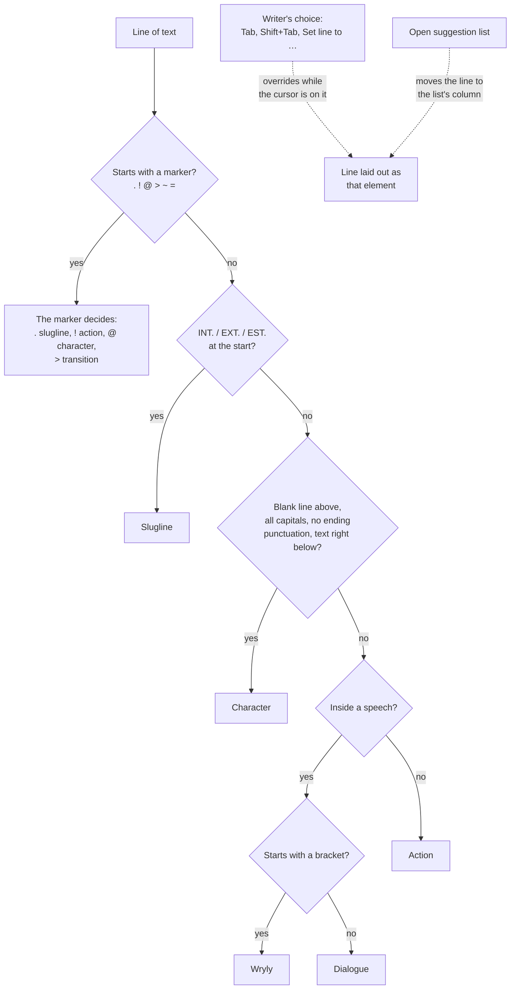

# Screenwriting editor behavior: decisions and test cases

This is a plain-English record of how Brass's script-mode editor should
behave while someone types a screenplay, and of the cases worth testing. Each
rule came from hands-on testing, and most match Fade In or Final Draft. It is
written to be read by people and by AI coding assistants. Keep it up to date
when a behavior changes, and test against it before a release.

Notation used below:

- `|` is the cursor.
- "Left margin" is where sluglines and action sit. "Character column" is the
  centered position of a character name (the cue). Dialogue and wrylies have
  their own indents.
- "Strict" means the **Strict cursor placement** setting is on (the default in
  script mode).

## How the editor decides what a line is



## Core principles

1. **The cursor's column must always match what will be printed.** If the
   cursor sits in the character column, the writer expects a character name.
   If it sits at the left margin, they expect action or a slugline. Never show
   a list or column that disagrees with the other.
2. **Don't guess too early.** A line in capitals stays action until it is
   clearly a character: the character list matched it, the writer pressed
   Enter, or text was typed right under it. "INTENSE MUSIC" while typing must
   not jump to the middle of the page.
3. **The writer's explicit choice wins.** Tab, Shift+Tab and the **Set line to
   …** commands override the automatic guess for the line the cursor is on.
4. **Valid Fountain by default, broken formatting by choice.** **Tab and
   Enter never produce improper formatting**, in any mode, however they are
   chained: no wryly right after a wryly, no empty `()` left behind, no
   split `(` and `)`. With strict cursor placement on (the script mode
   default), accidents are guarded against too: no text at the action margin
   glued under dialogue, no lone `(` or `)` on a wryly line, no typing on
   the single blank line that separates two blocks. In plain mode, or with
   strict off, the writer is free to break formatting on purpose by typing
   it; the keys that fill in and skip still must not.
5. **Match Fade In / Final Draft when in doubt.** Writers come from those apps
   and their muscle memory should work.
6. **The text is plain Fountain.** Layout is display only. Anything that would
   change how another Fountain app reads the file belongs in export options,
   not in the editor.

## Indented action

- Spaces at the start of an action line indent it (`    Scott --`), in the
  editor and, with **Indent action with spaces** on (the default), in the
  preview and FDX export, on every wrapped line.
- Tabs don't indent action: the Tab key moves between elements.

## $ variables (Brass addition)

- Text after a `$` (`$my_variable`, `$ABC123`, `$1ABC`) shows in the theme's accent
  color, as a placeholder to fill in later.
- Dollar amounts (`$123`, `$123.12`, `$1,123.12`) aren't variables and stay plain.
  A trailing period or comma isn't part of the name.
- Apostrophes and hyphens inside a name are part of it (`$jen's_car`,
  `$dead-teacher-name`); quotes around it aren't (`'$name'`).
- Typing `$` lists the note's other variables, most used first, narrowed as
  you type (Suggestions on). Not after a letter or digit (`US$`), and not
  for dollar amounts.
- On or off per mode: **Highlight $ variables** in Typing in each mode.
- The `$` can be changed: **Variable character** in Suggestions (one
  symbol Fountain and Markdown don't already use, such as `%` or `&`).
- Two `$` on one line can look like Obsidian inline math (`$a and '$b`):
  Obsidian then renders the text between them as math.

## Enter in a code block (#358)

- On a ``` opening fence or inside a code block, closed or not, Enter is
  Obsidian's own: one new line, no screenplay spacing. After the closing
  fence, Enter is a screenplay Enter again.
  - [ ] ` ```| ` (no closing fence), Enter: ` ``` ` then `|`.
  - [ ] ` ``` ` / `The function.|`, Enter: one new line, `|`.
  - [ ] ` ``` ` / `One.` / ` ```| `, Enter: a blank line, then `|`.

## Lists that are no use close (#353)

- Like Fade In, a suggestion list closes once its only item is exactly
  what's typed (a space or line break the pick would add doesn't count).
  Enter and Tab then do their usual jobs.
- It stays when picking would change something (case, a filled-in time,
  the `+`), and over a selected part (Tab's Next part), where it's there to
  swap the part.
  - [ ] Characters FIONA, JEN, JENNY. New block, type `FIONA`: no list.
        Enter: `FIONA` then `|` on a dialogue line.
  - [ ] Type `JEN`: the list shows JEN and JENNY.
  - [ ] Wryly, type `(beat`: `(beat|)`, no list.

## + character names in action (Brass addition)

- Typing `+` lists the characters, narrowed as you type (`+je`,
  `+mary a`). Picking one replaces the `+` and the typed letters with the
  name. Not after a letter, digit or `+` (`C++`, `1+1`). Escape keeps what
  you typed.
- **In every element** (#354, 2026-11-26; was action only): dialogue,
  wrylies, sluglines, cues and transitions too. Sluglines, cues and
  transitions get the name in capitals.
  - [ ] Dialogue `I saw +fi|`, Enter: `I saw Fiona|`.
  - [ ] Wryly `(to +fi|)`, Enter: `(to Fiona|)`.
  - [ ] Slugline `INT. +fi|`, Enter: `INT. FIONA|`.
- **On a Markdown list line, Enter picks from an open list too** (#349),
  instead of Obsidian adding a new bullet. With no list open, Enter adds the
  bullet as usual.
  - `- text +z|` {Zorana listed}, Enter: `- text Zorana|`.
  - `- [ ] call +z|` {list}, Enter: `- [ ] call Zorana|`.
  - `- text|` {no list}, Enter: `- text` then `- |`.
- The name is written in mixed case: as the note already spells it in
  action (`McAllister`), or else each word capitalized (`Mary Ann`).
  Typed capitals (`+JE`) give capitals (`JEN`).
- **Groups** follow the names (#255, added 2026-11-22; #282): first groups
  the script already writes in action (`Jen and Blake`), most used first;
  then, from the scene's characters (everyone named in the scene so far,
  in cues or action, in order of appearance), each pair and the whole
  Oxford-comma list (after the first two pairs). A group already offered
  as a name (a character listed in frontmatter) isn't repeated. A few
  groups stay in view even when many names match.
- **Loose matching** (#286): spaces and commas needn't be typed
  (`+Jenandb` → `Jen and Blake`), and a name in a list can be just its
  start (`+j,b` → `Jen, Blake, and George`).
- **Typing a list** completes it name by name: after "and",
  `+Jen, Blake, and H` offers `Jen, Blake, and Helios`; after a comma,
  `+Jen, B` offers `Jen, Blake, and …` with each other scene character,
  then the whole scene.
  - [ ] Helios only in action earlier in the scene; type `+jen`: the list
        has `Jen and Helios` and a whole-scene list with Helios.
  - [ ] Type `+Jen, Blake, and H`, Enter: `Jen, Blake, and Helios|`.
  - [ ] Characters Jen and Jenna; scene speakers Jen, Blake, George; in
        action, type `+Je`: `Jen`, `Jenna`, `Jen and Blake`, `Jen and George`,
        `Jen, Blake, and George`.
  - [ ] Type `+Jen, B`, Enter: `Jen, Blake, and George|`.
- **In related notes** (#290): an outline or other note that belongs with
  a script (its project folder, its folder, or its `outline` property)
  gets the `+` list with the script's characters, and the `$` list with
  the script folder's variables; nothing else of the screenplay.
- Needs Suggestions on.
- The `+` can be changed: **Character name character** in Suggestions
  (one symbol, different from the variable character).

## Characters listed in frontmatter (Brass addition)

- A `characters` property in a screenplay note's frontmatter adds those
  names to the character lists (cues, `+` in action, capitals in action,
  the Insert character picker), even before they have dialogue:
  `characters: [Silent Man, "[[Old Woman]]"]` or `characters: Jen, Bob`.
  Links use their shown text.
- In a project, the project note's and every part's `characters` count.
- In the cue list they show "No dialogue blocks" and rank after the
  characters who speak. Statistics and character checks still count only
  real cues.

## Line comments (Brass addition)

- `// note` at the start of a line or after a space, to the end of the
  line, is a comment. It shows in a muted color (setting **Line comment
  color**; the theme's muted text by default, changed 2026-11-22) and is
  never part of the script.
- It doesn't change what a line is: `JEN // late` is still a character. A
  line that is only a comment is a note and doesn't end a speech.
- `https://` isn't a comment (no space before the `//`), and neither is `//`
  inside a boneyard (`/* ... */`).
- Clean exports handle them per format (**Line comments** in the Clean
  export table, #279): the clean Fountain export turns them into Fountain
  notes (`Dialogue. // late` → `Dialogue. [[late]]`), which Fountain apps
  show as notes and never print; Boneyard (`/* late */`), Keep and Remove
  are the other choices. Clean PDF and Final Draft remove them. Preview, PDF and FDX leave them out.

## Threads (Brass addition)

- `[&name]` ties lines together by name: every `[&…]` with the same name
  (case and extra spaces don't count) is one thread, in the script or in a
  note linked to it. For setups and payoffs, red herrings, motifs.
- It shows as 🧵. With the cursor on it or right next to it, the text shows
  (faded) so the name can be read or edited.
- Click: the next place in this note, wrapping at the end. Shift+click:
  the previous one. Alt+click: the next place across the project's parts
  (in order), its character pages and notes linked to or from them.
- Obsidian's **Follow link** hotkey (Alt+Enter by default) with the cursor
  on, in or right next to a thread (`|[&x]`, `[&x|]`, `[&x]|`) does what a
  click does. Elsewhere it follows links as usual.
- Ctrl/Cmd+click, or **Show threads**, opens the **Threads panel**, a tree
  like Obsidian's search results (#276, 2026-11-22): every thread the note
  can reach, most used first, with counts ("Used once" for a thread with
  one place). Click a thread (or its arrow) to open or close it: under it,
  each note that uses it, in script order, and under each note its lines.
  Notes can be closed too. **Expand all** and **Collapse all** at the top.
  Enter or Space toggles a row; Right opens, Left closes. Threads start
  closed; the one you Ctrl/Cmd+clicked opens, is highlighted and scrolled
  into view, and the others stay as you left them, also while you type.
  Click a line to go there (Ctrl/Cmd: new tab).
- Typing `[&` lists the thread names already used, most used first.
- **With text** (#289): `[&gun|the pistol]` shows as 🧵 then `the pistol`,
  at the script's size; with the cursor in it, the raw text shows. It is
  the same thread as `[&gun]`. The text is part of the script: the
  preview, counts and exports keep `the pistol` where the mark was.
  - [ ] `He finds [&gun|the pistol] under the bed.`, cursor elsewhere:
        `He finds 🧵the pistol under the bed.`; clean Fountain export: `He
finds the pistol under the bed.`
- It isn't script: a cue with a thread (`ZORANA [&x]`) is still a cue, a
  line holding only a thread is a note, and the preview, counts and every
  export leave threads out.

## Fenced code blocks

- Text inside a ``` or ~~~ fenced code block isn't script: it keeps
  Obsidian's look and line height, and no element rules (cues, dialogue,
  Tab, Enter) apply there.
- Only a block that starts with ```fountain is laid out as a script, on
  its own: a speech inside it doesn't carry on past the closing fence.

## Capitals: when is a line a character?

- A character cue is a line in capitals with a blank line above it and text
  right below it. "JEN (V.O.)" counts; the extension may be in any case.
- **Capitals ending in punctuation are action:** "BANG!", "SILENCE.",
  "BOOM?". An extension after the name is fine: "JEN (V.O.)".
- **Exception while editing:** an extension whose `)` was deleted
  ("JEN (V.O.") is still being typed. The line stays a character.
- A name forced with `@` is always a character, whatever its case.
- One capital letter on its own ("S" of "She runs") never opens the
  character list. Two capitals ("JE") can.
- Option: **Character suggestions match capitals.** On (default), typing
  must be in capitals to open the list. Off, "Je" also finds JEN.
- On Fountain export, an option puts `!` in front of capitals that Brass
  reads as action but other apps would read as a character ("BANG!" with text
  below becomes "!BANG!"). The script itself is never changed.

Test cases:

- [ ] Type `INTENSE MUSIC` on an action line: it stays at the left margin.
- [ ] Type `JE` with JEN in the script: the list opens and the line moves to
      the character column.
- [ ] Type `BANG!`, press Enter, type text: `BANG!` stays action.
- [ ] Backspace from `JEN (V.O.)|` down to `JEN`: it stays a character at every
      step.
- [ ] Type a new name that isn't in the script after Tab: it is typed in
      capitals and stays in the character column.

## Menus and the cursor's column

- If the **slugline list** is showing, the cursor is at the left margin.
- If the **character list** is showing, the cursor is in the character
  column. The slugline list never shows in the character column.
- Typing `IN` on an action line opens the slugline list and keeps the cursor
  at the left margin.
- A line set to action (Escape, Shift+Tab) gets only the slugline list
  (`IN`), never the character list.
- Capitals at the start of a block that begin a transition (`CUT T`,
  `SMASH`) list the transitions, after any matching characters. A pick
  writes `CUT TO:` as it is and adds `>` to others (`> FADE OUT.`).
- `@` or `@j` (a forced cue) lists the characters, in any case.
- Setting **Suggest character names in action** (on by default since 2026-11-22): capitals
  typed inside an action line (`She sees JE`) list the characters starting
  with them, like Final Draft's SmartType. Enter writes the name in the
  line (no `@`, no line break). Not at the start of a block (that is the
  cue list), nor in dialogue or a slugline.
- Typing `)` right before the `)` closing a wryly or extension steps over
  it, as in Fade In.
- A line set to dialogue (Shift+Enter) that starts with `(` is a wryly.
- Typing `JOHN (` or `JOHN(` opens the extension list: (O.S.), (V.O.),
  (ON RADIO), (ON PHONE), then the other extensions the script already uses,
  most used first (`(UNINTELLIGIBLE)` once it's been typed). Setting **Your
  extensions first** (off by default) puts the script's own before the
  standard ones. For a name not yet in the script it opens only on a line
  already set to a character (Tab, the Character button) that starts a block
  (changed 2026-11-22; narrowed 2026-11-26, #348). In action, a new name and
  `(` stay action, because characters are introduced that way:
  - `TYLER (|`: action, no list. `TYLER (30) walks in.|`: action.
  - `TYLER (30s)|`, Enter: a cue, with a dialogue line below (the line ends
    without punctuation, see below).
  - Empty line, Tab (character column), `TYLER (|`: the extension list.
  - `JANE (|` in action with JANE already a cue in the script: the list.
- **A cue whose text is deleted stays a cue line** (list open, capitals),
  and a name pasted there is put in capitals.
- **An empty line after a speech is the next cue's line only when nothing
  is right below it.** With text right below, it stays a plain line.
- **Deleting back into an empty part reopens its list**: "()" (wrylies),
  "INT. " (locations), "INT. CAR - " (times), "JEN (" (extensions).
- **An empty line in the character column always acts as a cue line,**
  however the cursor got there (Tab, Enter, deleting back to it, arrowing
  onto it): the character list opens and typing is in capitals. Escape or
  Shift+Tab makes it action.
- When the line was moved to the character column (Tab, or after a speech),
  only character suggestions show: no transitions, sluglines or wrylies.
- Escape on an empty character-column line closes the list and moves the
  line to the left margin.
- **Escape is remembered for that line:** arrowing away and back keeps it
  action with no list (also after Shift+Tab or Backspace), until it has
  text.

Test cases:

- [ ] For every list (sluglines, scene types, locations, times, characters,
      extensions, transitions, wrylies), check which column the cursor is in
      while the list shows. Do it in an empty script, in a script with no
      characters yet, and in a long script.
- [ ] Escape out of each list and check the column again.

## Enter

| On a…      | Enter starts                   |
| ---------- | ------------------------------ |
| Slugline   | Action                         |
| Action     | Action                         |
| Character  | Dialogue                       |
| Wryly      | Dialogue                       |
| Dialogue   | Character (after a blank line) |
| Transition | Slugline                       |

- Enter at the end of a capitals line turns it into a character only if it
  does not end in punctuation (a closing extension like `(V.O.)` is fine).
- **Shift+Enter** is a plain line break, and the new line is the same
  element as the line the cursor was on: after dialogue the cursor stays in
  the dialogue column. Strict on or off, Smart Enter on or off. The
  element is read after the split, from the part left above:
  `CHARACTER|Test.` gives a cue and `TEST.` on a new cue line.
- **Enter at the end of a line in the middle of a speech** (a cue, wryly or
  dialogue line with more of the speech right below): with strict on,
  no line is added. A new block there would cut the speech in two. After
  a wryly (`(quietly)|` or `(quietly|)`) the cursor moves to the start of
  the dialogue below, as in Final Draft and Fade In; after a cue or
  dialogue it stays.
- **Enter at the start of an action paragraph** (strict on, with a blank
  line above): the paragraph moves down with the cursor, leaving an empty
  action above it, as in Fade In (changed 2026-11-21; it used to do
  nothing).
- **Enter at the start of a dialogue or wryly line inside a speech**: with
  strict on, adds an empty dialogue line above, as in Fade In. In the file
  that line holds two spaces (Fountain's blank line inside dialogue), so the
  speech goes on past it. The first letter typed there replaces the spaces.
  Right under the cue or a wryly (the first dialogue line), nothing
  happens: a blank line there would part the cue or wryly from its
  dialogue, and Fountain would no longer read the cue as one.
- **Backspace or Delete on that blank speech line** (two spaces) removes the
  whole line, so the speech is whole again. Backspace ends at the end of
  the line above, Delete at the start of the text below.
- **Enter in the middle of a line** follows the **Enter inside a line**
  table (below). Where it splits the line, spaces at the split go:
  `Hi |there.` gives `Hi` and `there.`, with no space left at the end of
  the line above.
- Enter's element logic has its own switch, **Smart Enter**, apart from
  **Smart Tab**, so the two keys can behave differently (as in Fade In:
  Tab after `INT. OFFICE` adds `-` and the time list; Enter starts action).
- Each row is a setting (**Tab and Enter keys**), so writers can change it.
  Some writers expect Enter after a wryly to go to the character column; the
  default is dialogue.

- **Enter never leaves improper formatting (strict, both modes):**
  - On an empty line, or at the start of a line, with a blank line above:
    nothing. The line is already where the next element goes.
  - At the end of an unfinished slugline (`INT.`, `INT. HOUSE - `):
    nothing.
  - On an empty `()` with the wryly list closed (or in plain mode): with
    more of the speech below, the `()` line goes and
    the cursor moves down to it; under a cue, the line becomes the dialogue
    line; after dialogue, the `()` goes and Enter goes on from the end of
    the dialogue (a new character in script mode).
  - At the start of dialogue right under a wryly: nothing.
  - Fountain mode keeps Obsidian's Enter otherwise, but these rules and
    "Enter inside a speech does nothing" apply there too.
- **Tab after a bare scene type** (`INT.`) adds a space and opens the
  location list, not `-`. **Tab on an empty `()` with dialogue below**
  drops the `()` and lands on the dialogue. **Obsidian's Tab** (Tab inside
  a line setting) never inserts a tab character in a screenplay.

### Enter inside a line

- **Strict on, inside action:** Enter starts a new paragraph, with a blank
  line between and the spaces at the split dropped
  (`Fiona laughs. |Jen reads` → `Fiona laughs.`, blank, `|Jen reads`).
  Shift+Enter is the plain break that keeps one paragraph.

What Enter does with the cursor inside an element, past its first letter
and before its end. Each element has its own setting, set separately for
script and Fountain mode (Settings > Tab and Enter keys > Enter inside a
line):

| Element                                | Choices                                             | Script default | Fountain default |
| -------------------------------------- | --------------------------------------------------- | -------------- | ---------------- |
| Slugline, Character, Wryly, Transition | Nothing, Line break, Obsidian's Enter, Next element | Nothing        | Line break       |
| Action, Dialogue                       | Nothing, Line break, Obsidian's Enter, Next element | Line break     | Line break       |

- **Line break:** the rest of the line moves to a new line exactly as typed
  (`INT. CAR| - DAY` gives ` - DAY` on the next line, cursor at its start).
- **Obsidian's Enter:** as in a normal note; it may continue a list or a
  quote.
- **Next element:** the cursor goes to the start of the next element.
- **Nothing:** the line can't be split. In script mode this is the default
  for lines that splitting would mangle.
- "(beat|)" counts as the end of a wryly, so Enter there goes on to the
  dialogue as usual.
- "BOB (V.O.|)" counts as the end of the cue in the same way: Enter goes
  on to the dialogue line (added 2026-11-22).
- Strict: Enter at the end of a cue with the speech already below moves
  the cursor to the start of the line below (dialogue or wryly). Setting
  **Enter at the end of a character moves to the dialogue** (on by
  default); off, Enter adds an empty dialogue line under the cue instead,
  as in Fade In. That line holds two spaces, so the speech stays whole
  (added 2026-11-22).

## Tab

| On a… (at the end of the line) | Tab starts |
| ------------------------------ | ---------- |
| Action                         | Character  |
| Character                      | Wryly      |
| Wryly                          | Dialogue   |
| Dialogue                       | Wryly      |
| Slugline                       | Action     |
| Transition                     | Slugline   |

Special cases, all decided during testing:

- **Tab at the end of an action line** goes to the character column, even
  in a script with no characters yet (the list is empty but the column is
  right).
- **Tab at the start of an action line with text** turns that line into a
  character (in capitals), if the line can be a name (`jen`, `BOB (V.O.)`).
  A sentence (`She runs to the door.`) stays action, as in Fade In. Only
  action does this; other elements keep their own Tab.
- **Tab after a slugline's time** (or its modifier) starts the action, as
  in Fade In. Type ` (` after the time for the modifier list.
- **Tab at the start of dialogue with text** adds an empty wryly `(|)`
  above it. Setting **Tab at the start of dialogue adds a wryly**; off,
  Tab does nothing there, as in Fade In.
- **Tab in an empty `()` on its own block** (no cue above, e.g. after Set
  line to wryly) clears it to an empty action line: a wryly can't stand
  without a cue.
- **Tab in the middle of dialogue** (Add a wryly here) splits the speech
  around `()` and leaves the spaces at the split at the end of the line
  above, unseen, so deleting the empty `()` joins the speech back exactly.
- **Tab at the start of dialogue right under a wryly** does nothing.
- **Tab at the end of a wryly** (`(beat|)` or `(beat)|`) with dialogue right
  below moves the cursor to the start of that dialogue. With nothing below,
  it starts a new dialogue line.
- **Typing a wryly with its list open** (`(bea|)`): one Tab or Enter picks
  it and goes on to the dialogue, as in Fade In.
- **Tab or Shift+Tab in an empty `()` under a character** (`JEN` / `(|)`)
  with nothing below: the `()` goes and the line becomes the dialogue line,
  as in Fade In. With the wryly list open too. A bare `(` counts. With
  dialogue right below, both drop the `()` and move to it (added
  2026-11-22).
- **Enter in an empty `()` with the wryly list open** (script mode) picks
  the highlighted wryly and goes on to the dialogue, like a typed one
  (changed 2026-11-21: the list shows a highlighted item, so Enter picks
  it). With the list closed, it follows the empty-`()` rules under Enter.
- **Tab on an empty line that was moved to the left margin** (by Backspace,
  Shift+Tab or Escape) moves it back to the character column and opens the
  character list.
- **Tab in the middle of a line** follows the **Tab inside a line** table
  (below).
- **Tab never puts tab characters into the script.** When Tab has nothing
  to do (two cursors, a selection over several lines, Smart Tab off), it
  does nothing. Lists, tables and code blocks keep Obsidian's Tab.

- **Under a wryly, never another wryly.** On the empty dialogue line under
  an empty `()` (made by hand), Tab drops the
  empty `()` and goes to a new character; Enter does the same as Enter at
  the end of the line above it (a new character after dialogue). Under a
  wryly with text, `(beat)`, Tab does nothing: its dialogue goes there.

### Tab inside a line

What Tab does with the cursor inside an element, not at its end. Each
element has its own setting, set separately for script and Fountain mode
(Settings > Tab and Enter keys > Inside a line). Fountain mode starts with
Obsidian's Tab, as in a plain text note:

| Element                   | Choices                                                                            | Script default   | Fountain default |
| ------------------------- | ---------------------------------------------------------------------------------- | ---------------- | ---------------- |
| Slugline                  | Nothing, Obsidian's Tab, Next part, Next element, As at the end of the line        | Next part        | Obsidian's Tab   |
| Character                 | Nothing, Obsidian's Tab, Next part, Next element, As at the end of the line        | Next part        | Obsidian's Tab   |
| Dialogue                  | Nothing, Obsidian's Tab, Add a wryly here, Next element, As at the end of the line | Add a wryly here | Obsidian's Tab   |
| Action, Wryly, Transition | Nothing, Obsidian's Tab, Next element, As at the end of the line                   | Nothing          | Obsidian's Tab   |

- **Next part** (only sluglines and characters have parts):
  - Character: from the name to the extension. With no extension yet, the
    cursor goes after the name and the extension list opens
    (`CHARACTER |`). With one, it is selected and the list opens with it
    picked (`CHARACTER ([V.O.])`): Enter or Escape keeps it, another pick
    or typing replaces it.
  - Slugline: scene type, then location, then time, then modifier. A part
    that isn't there yet is added the way Tab at the end of the line adds
    it (`-` and the times, or the modifier list).
  - The current text is always first in the list, even when the script
    doesn't count it yet (the line's own new location), so Enter never
    changes it by accident.
  - One Tab per part: with the part's own text highlighted, Tab keeps it
    and goes on to the next part. Picking another choice replaces the part
    and leaves the cursor at its end, without opening the next list by
    itself.
  - Text after the last `-` is the time only if it is a known time (from
    the settings or the rest of the script). Otherwise it belongs to the
    location: `INT. HOUSE - KITCHEN`.
- With a part left selected (after Escape), Tab carries on from the end of
  the selection. It never falls through to Obsidian's Tab, which would
  indent the whole line.
- **Next element** skips the parts and goes to the start of the next
  element: `CHARA|CTER (V.O.)` goes to `|Dialogue.`. It skips lines that
  aren't script: `#` headings, comments and notes.
- **As at the end of the line:** Tab does what it does at the end of the
  line. `My |action.` + Tab gives `My action.`, a blank line, and the
  character column with its list (as in Arc Studio Pro).
- The start of an action line and the start of dialogue keep their own Tab
  rules (see above); the table covers the rest of the line.

Test cases:

- [ ] `CHARA|CTER` and `CHARA|CTER (V.O.)` with each choice.
- [ ] Every part of `INT. KITCHEN - DAY (FLASHBACK)`, and the same slugline
      with parts missing.
- [ ] Next part on a cue whose extension isn't a standard one
      (`JEN (FILTERED)`): Enter keeps it.

### Shift+Tab inside a line

- **Shift+Tab inside a slugline or character** (#287; setting, script
  mode Previous part, Fountain mode Nothing): selects the part before the
  cursor and opens its list, as Tab's Next part goes forward. With nothing
  selected, the part the cursor is in or just after; with a part selected,
  the one before it. It stops at the location (the scene type isn't a
  part with a list) and at a cue's name. Other lines keep their Shift+Tab.
  - [ ] `INT. BARN - DAY|`, Shift+Tab: `INT. BARN - [DAY]` with the times
        list; again: `INT. [BARN] - DAY` with the locations; again: no change.
  - [ ] `JEN (V.O.)|`, Shift+Tab: `JEN ([V.O.])` with the extensions.
  - [ ] `She runs|.` (action), Shift+Tab: nothing changes.

## Backspace and Delete (strict)

- Backspace on an **empty character-column line** does not delete the line.
  It moves the cursor to the left margin on the same line (an empty action
  line). The next Backspace goes to the end of the line above, never onto
  the blank separator line. Setting **Backspace on an empty character line
  makes it action**; off, the first Backspace deletes the line and goes to
  the end of the text above, as in Fade In.
- **Delete on the blank line under a name in capitals standing alone** (or
  Backspace at the start of the line below) removes the blank line: the
  name becomes a cue and that line its dialogue. It never joins them as
  action (`GEORGE Mm.`).
- Enter on the empty dialogue line under a character or wryly does
  nothing: a character needs its dialogue. Type it, or Backspace (back to
  the character) or Shift+Tab (action).
- A character whose dialogue or wryly was deleted keeps the character
  column while the cursor stays on it. When the cursor leaves, a
  character with nothing under it shows as action, which is how Fountain
  reads it.
- **Two action blocks join**: Backspace at the start of an action block
  right after another one (or Delete at the end of the first) makes one
  paragraph, with a space between, as in Fade In. A line holding only a
  thread counts as action here (#350), though it reads as a note elsewhere
  so it doesn't break a speech:
  - `Test. Test.` / blank / `|[&black widow Fiona]`, Backspace:
    `Test. Test. |[&black widow Fiona]`.
  - A line holding only a comment (`// note`) doesn't join this way.
- Backspace at the start of a block goes to the end of the block above,
  and Delete at the end of a block does nothing: the single blank line
  between two blocks can't be deleted this way (it would merge them). An
  extra blank line can.
- **A whole cue selected, then Backspace or Delete**, right after another
  speech: the cue and the blank line above it go, and its dialogue carries
  on the speech above, as in Fade In. After action (or a slugline), only
  the cue line goes: its dialogue stays on its own line as action.
- **Shift+Backspace / Shift+Delete join on purpose**: at the start of a
  line, Shift+Backspace joins it onto the line with text above; at the end
  of a line, Shift+Delete joins the line with text below onto it. Blank
  lines between go, and the joined text takes the upper line's element (in
  capitals onto a slugline, cue or transition). Mid-line they delete one
  character. Strict on or off.
- Backspace and Delete never join two different elements (a character and
  its dialogue, for example). The cursor moves instead.
  **Shift+Backspace** joins them on purpose.
- **Wrylies never leave a lone bracket:**
  - Backspace or Delete anywhere on an empty `()` removes the whole line and
    puts the cursor at the end of the dialogue above. In the middle of a
    speech (dialogue above and below), the two dialogue lines join back
    into one.
  - Backspace or Delete that would leave only `(` or `)` (for example
    Backspace at `(b|`) removes the whole line the same way.
  - A wryly with text in it edits one character at a time as normal.
  - A wryly standing on its own block (a blank line above it, for example
    after **Set line to wryly** on an empty line) is cleared in place
    instead, leaving an empty action line, so the blank line between blocks
    stays.

Test cases:

- [ ] Every Backspace and Delete position on `|()`, `(|)`, `()|`, `(b|`,
      `(|b`, `(b)|`, `(|b)`.
- [ ] Backspace from an empty character-column line, twice.
- [ ] Backspace at the start of dialogue (must not join the character).

## Set line to … commands

- Every command moves the line to the new element's column at once, even if
  the line already has text or was set to something else before.
- **Set line to action** on a wryly removes the brackets: `(text)` becomes
  `text`. On capitals that would read as a character, it adds `!`.
- **Set line to slugline** on a wryly gives `.(TEXT)` at the left margin. A
  forced slugline is a `.` followed by anything except another `.` (an
  ellipsis) or a space.
- **Set line to character** uppercases the text, or adds `@` if it still
  wouldn't read as a character.
- After a line is set to character, anything typed on it is uppercased
  (setting: **Uppercase character names as you type**).
- A line holding only an element's start (`> `, `()`, `.`) counts as empty:
  it starts over as the new element (#360). `> ` set to slugline is an empty
  slugline line with the scene types open, not a lone `.`.

### Cycle button on the phone toolbar (#360)

- 🔄 Cycle changes the cursor's line to the next element: slugline, action,
  character, transition, then slugline again. On an empty line it changes
  the element the line is about to become (its column and list); on a line
  with text it converts the text, as the Set line to commands do. A blank
  line or another element (centered) counts as action, so it goes to
  character next.
- Under a character (the line right below a cue, wryly or dialogue), only
  wryly and dialogue keep the speech valid Fountain, so it toggles between
  them. Fade In cycles through every element; Fountain infers dialogue from
  the cue above, so the other elements can't sit there.
- Taps in a row convert the line's text from before the first tap, so going
  round doesn't pile up changes: `she waits` round to action is `she waits`
  again, not `!SHE WAITS`. Any other edit or moving the cursor ends the run.
- ⬅️ Smart Tab back is hidden by default (Cycle takes its place); the
  Phone toolbar setting can show it again. Cycle replaced the Convert
  button and its placement setting; a saved Convert button becomes Cycle in
  its place.
  - [ ] Empty line after action, Cycle ×4: character column (list), `> `
        with transitions, slugline column with scene types, action column.
  - [ ] `she waits|`, Cycle ×4: `SHE WAITS`, `> SHE WAITS`, `.SHE WAITS`,
        `she waits`.
  - [ ] `FIONA` / `hello there|`, Cycle: `(hello there)`; again:
        `hello there`.
  - [ ] `FIONA` / `|`, Cycle: `(|)` with the wryly list; again: `|` as
        dialogue.

- **Toggle dual dialogue** (command, #211): with the cursor anywhere in a
  speech, adds ` ^` to its cue (`BLAKE` → `BLAKE ^`), or removes it. It
  needs a speech right above, with only blank lines between, that isn't
  already the second half of a pair; otherwise a notice says why.
  - [ ] Cursor in BLAKE's dialogue under JEN's speech, run it: `BLAKE ^`,
        cursor still in the dialogue. Run it again: `BLAKE`.
  - [ ] Cursor in the first speech of a scene: a notice, nothing changes.

## Automatic capitals while typing

- Sluglines are uppercased as you type, once the line reads as one
  (`int.` becomes `INT.`).
- Text after `>` (a forced transition) is uppercased.
- A short line ending in `to:` on its own block (`cut to:`, up to three
  words, blank line above) goes into capitals when the `:` is typed, as a
  slugline does at `int.`. Same setting as above.
- Script mode: Enter on a short line ending in `to:` on its own block
  (`cut to:`, `Smash cut to:`, up to three words) puts it in capitals as a
  transition and starts a slugline, as in Fade In.
- Fountain mode: Enter after a `>` line is a plain line break (Obsidian
  would continue it as a quote).
- The first letter of each line is capitalized, except lines starting with
  a symbol like `(`.
- The first letter of each sentence inside a line is capitalized too
  (`She runs. he follows.` → `He`), but not after an ellipsis, an
  abbreviation (`Mr.`, `INT.`, `p.m.`) or an initial (`J.`), and not in
  pasted text (added 2026-11-21).
- **The location list** shows each location with what picking it fills
  in: the location plus the time and modifier of the last slug that used
  it (`STUDIO, BARN - NIGHT (FLASHBACK)`; #284, changed 2026-11-23).
  Setting **Picking a location fills in**: Time and Modifier checkboxes,
  both on. With both off, picking fills in `KITCHEN - ` and opens the
  times with the last one first (the 2026-11-21 behavior). A whole-slug
  pick closes the list; the next Enter goes on to action.
  - [ ] `INT. STUDIO|`, Enter on `STUDIO, BARN - NIGHT (FLASHBACK)`:
        `INT. STUDIO, BARN - NIGHT (FLASHBACK)|`, no list.
  - [ ] `INT. STUDIO|`, Down, Enter, Enter: `INT. STUDIO - NIGHT`, then a
        new action line.
  - [ ] Time and Modifier off: Enter on `KITCHEN - NIGHT` gives
        `KITCHEN - |` with the times open.
- **Offer full slugs** (setting, off by default): the location list also
  offers each location's last whole slug (`KITCHEN - NIGHT (FLASHBACK)`),
  which fills in the whole line at once. **Order of slug suggestions**
  (drag, or the Move button) sets which of a location's two items comes
  first: most recent (the whole slug) or shortest (the location, then the
  times). A location never used with a time or modifier has one item
  (added 2026-11-21).
- **Mini sluglines** (a forced heading, `.HALL`): the location list also
  has a bare `HALL` item (detail "No time"), which fills in just the
  location, with no `-` and no times list. It comes right after the
  location item, or first when that location's last slug had no time
  (`.HALL` used bare before). Slugs with a scene type (`INT. HALL`) keep
  the usual list (#256, added 2026-11-22).
  - [ ] `.HALL - NIGHT` earlier; type `.HA`, Down, Enter: `.HALL|`.
  - [ ] `.HALL` used bare last; type `.HA`, Enter: `.HALL|`.
  - [ ] `INT. HA`: no "No time" item.
- **Times of day after a location**: the time that location had last
  comes first (`INT. KITCHEN - ` after `INT. KITCHEN - NIGHT` puts NIGHT at
  the top), when it matches what is typed (added 2026-11-21).
- **Status bar pages, runtime, words and scenes** count what the clean
  PDF would hold: tasks, comments, callouts and the other elements the
  Clean export table's PDF column strips don't add pages (changed
  2026-11-21; PDF column since #277).
- Text typed in the character column is uppercased, and so is text typed
  on a cue already in the script (`HELIOS|` + `test` → `HELIOSTEST`), so
  it stays a cue. Not inside the extension's brackets.
- Each of these is a per-mode setting: on in script mode, off in plain mode.

## Fade In comparison

Tested on 2026-11-17 by sending real keystrokes to Fade In (Windows) and
running the same steps in Brass (script mode, strict cursor
placement on, default settings). Fade In has no Fountain markers: each
line has an element, shown in its Format panel.

### Same in both

| Steps                                                | Result                                                  |
| ---------------------------------------------------- | ------------------------------------------------------- |
| Tab at the end of an action line, or on an empty one | Character column, character list open                   |
| Type a name in the character column                  | Typed in capitals, even a new name                      |
| Enter after dialogue                                 | New character line, list open                           |
| Tab at the end of a character name                   | `()` wryly, cursor inside                               |
| Tab at the end of dialogue                           | `()` wryly below                                        |
| Tab on an empty dialogue line                        | `()` wryly                                              |
| Backspace on an empty `()`                           | Wryly line removed, cursor at the end of the line above |
| `int.` on an action line                             | Scene heading, whole line in capitals                   |
| Tab at the end of `INT. OFFICE`                      | `-` and the time list                                   |
| Enter after a scene heading                          | Action                                                  |
| Enter after a transition                             | Scene heading, scene type list open                     |
| Shift+Tab on an empty character line                 | Action                                                  |
| `BANG!` then Enter                                   | Stays action                                            |

### Different

| #   | Steps                                                                | Fade In                                           | Brass                                                               | To match Fade In                                                                             |
| --- | -------------------------------------------------------------------- | ------------------------------------------------- | ------------------------------------------------------------------- | -------------------------------------------------------------------------------------------- |
| 2   | Character list after a speech                                        | Alternates: the other speaker first               | The other speaker first                                             | Same (corrected 2026-11-19)                                                                  |
| 3   | Escape with the character list open on an empty line                 | Line stays a character                            | Line becomes action, remembered for that line                       | Keep Brass's (decided 2026-11-19)                                                            |
| 4   | Backspace on an empty character line                                 | Line deleted, cursor at the end of the line above | Line stays, moves to the action margin                              | Setting: Backspace on an empty character line makes it action → off                          |
| 5   | Type `beat` in `(                                                    | )`, then Tab or Enter                             | Closes `(beat)` and goes to a new dialogue line                     | Picks `(beat)` from the list and stays on the wryly line; a second press moves on            | Fixed 2026-11-17: now the same as Fade In |
| 6   | Enter in an empty `(                                                 | )`                                                | Goes to dialogue, `()` stays                                        | The wryly list's first item `(beat)` is picked                                               | Fixed 2026-11-17: now the same as Fade In |
| 7   | Tab at the start of dialogue with text                               | Nothing                                           | `()` added above                                                    | Setting: Tab at the start of dialogue adds a wryly → off                                     |
| 8   | Tab in the middle of dialogue                                        | Nothing                                           | Splits the speech with a wryly                                      | Setting: Tab inside a line → Dialogue → Nothing                                              |
| 9   | Tab in the middle of a character name or slugline                    | Nothing                                           | Next part                                                           | Setting: Tab inside a line → Nothing                                                         |
| 10  | Tab at the start of an action line with text                         | Nothing                                           | Line becomes a character. Mixed case gives `@She runs to the door.` | Fixed 2026-11-17: a sentence now stays action; a name still becomes a character              |
| 11  | `JOHN` in action, then Enter                                         | Stays action                                      | Becomes a character, dialogue next                                  | Keep Brass's (decided 2026-11-19: Fountain reads it as a cue)                                |
| 12  | Enter on an empty dialogue line                                      | That line becomes a new character line, list open | The cue above becomes action and the cursor starts a new block      | Decided 2026-11-17: Enter does nothing there (Fade In's result can't be written in Fountain) |
| 13  | Tab after a transition                                               | Action                                            | Scene heading                                                       | Setting: Tab and Enter keys → Transition → Action line                                       |
| 14  | Tab after a slugline's time (`INT. OFFICE - DAY`)                    | Action                                            | Modifier list; a second Tab adds FLASHBACK (roadmap #117)           | Fixed 2026-11-17: now the same as Fade In                                                    |
| 15  | Tab in an empty `()` on its own block                                | Line becomes empty dialogue                       | Line becomes an empty action line (2026-11-19)                      | Keep Brass's (a wryly or dialogue can't stand without a cue)                                 |
| 16  | A cue left with no dialogue under it (after deleting the line below) | Still a character                                 | Shown at the action margin                                          | Fixed 2026-11-17: keeps the character column while the cursor stays on it                    |
| 17  | Type `(` on a dialogue line                                          | Stays dialogue                                    | Becomes a wryly, list open                                          | Keep Brass's (it matches Fountain)                                                           |
| 18  | Enter on an empty action line                                        | Another empty action line                         | Strict mode keeps a single blank line between blocks                | Keep (strict mode's purpose)                                                                 |

Not compared: Enter on an empty character line with the list closed (in
Brass, Escape already turns the line into action, see #3), and a
lowercase `cut to:` typed on its own block.

## How to test

- Test in the real app, not only with unit tests. Many bugs only show when
  the layout, the suggestion list and the cursor rules run together.
- Reload the plugin after every build. Several "still broken" reports during
  testing were an old build.
- For each case, write down the starting text with `|`, the key pressed, what
  happened, and what should happen. That format made every fix in this list
  quick to understand and verify.
- Check both the text and the column. A fix can produce the right text with
  the cursor in the wrong column, or the other way round.
- Test with the setting on and off for every behavior that has one.
- Re-run the earlier cases after each fix; rules here interact (Backspace,
  Tab and the suggestion list all touch the same empty line).
